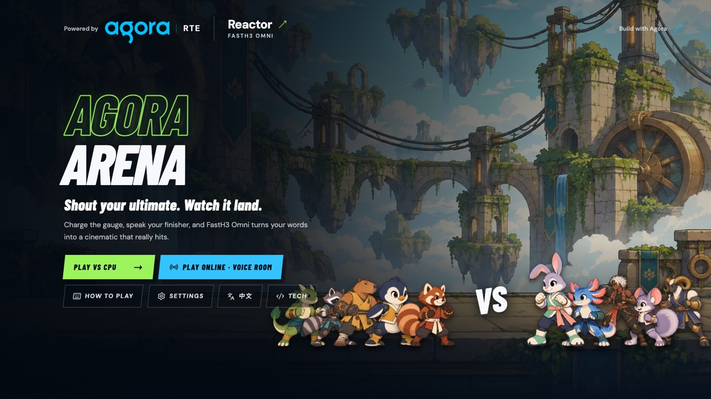
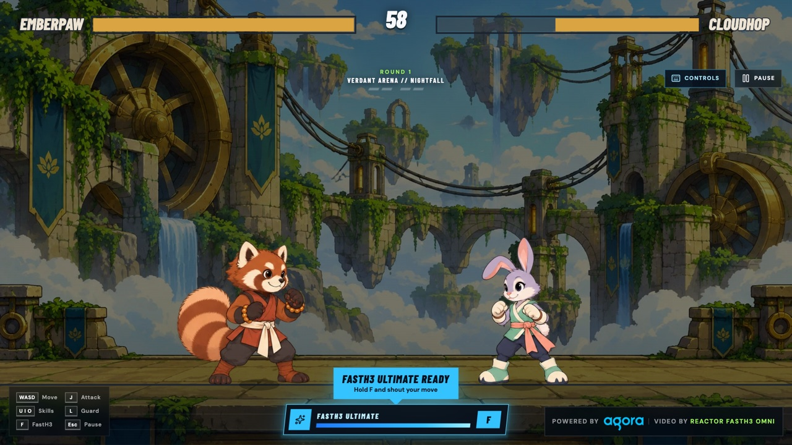
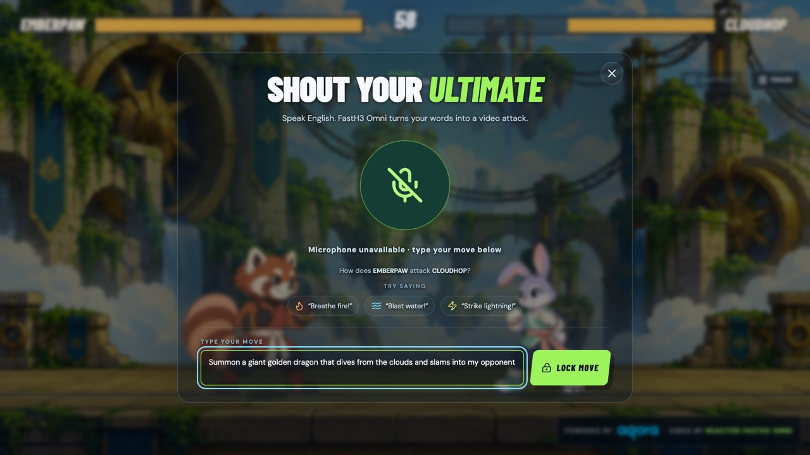
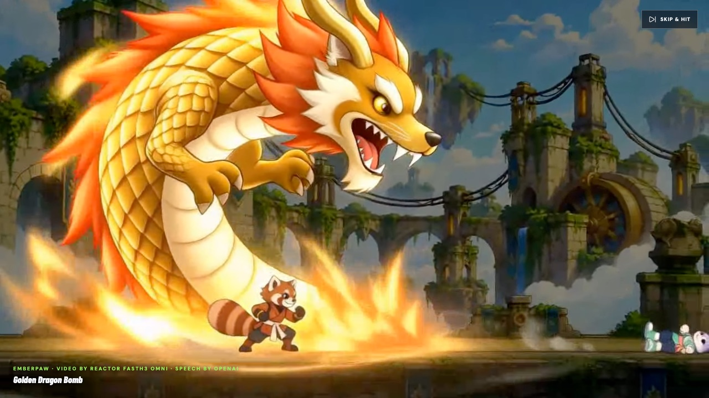
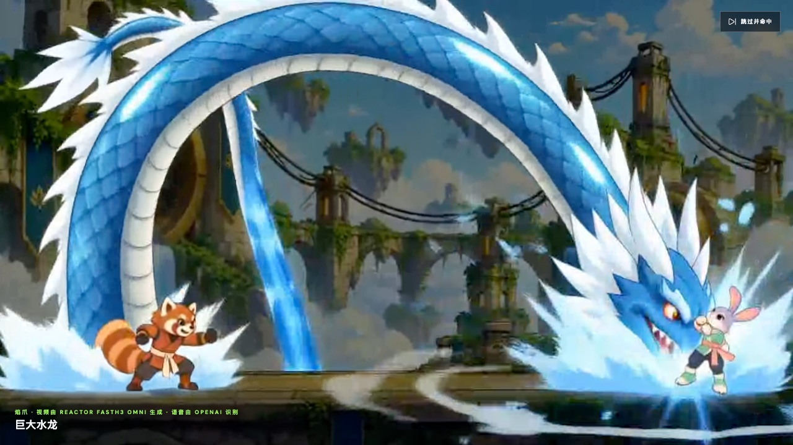
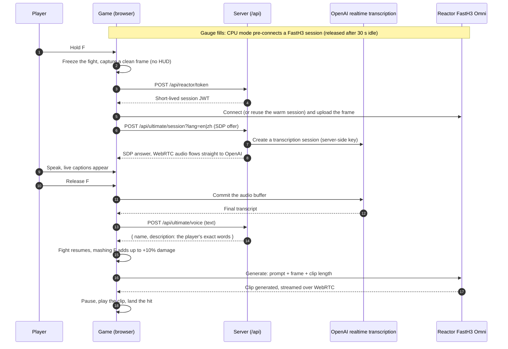

<div align="center">

# Agora Arena

A browser fighting game where your finishing move is whatever you say out loud, built with Agora RTC + RTM for real-time voice and multiplayer, OpenAI realtime transcription for speech, and Reactor FastH3 Omni for AI video.


**English** · [简体中文](./README.zh-CN.md)

</div>

---

Fill the gauge, hold **F** and describe an attack. [Reactor FastH3 Omni](https://www.reactor.inc/models/fast-h3-omni/info) turns it into a cinematic that starts from the live fight frame, then the hit lands in the game. Play the CPU, or a friend online in an [Agora](https://www.agora.io) voice room.



| Fight | Speak or type your ultimate |
|---|---|
|  |  |
| **"Golden Dragon Bomb"** | **"Giant Water Dragon"** |
|  |  |

The bottom row is real FastH3 Omni output from this code.

## How a voice ultimate works



- The captured frame becomes the clip's first frame, so the cinematic starts where the fight stopped.
- The prompt ([`src/game/ultimatePrompt.ts`](src/game/ultimatePrompt.ts)) follows Reactor's prompt guide: both fighters' looks, which side the caster is on, the player's words, three beats (appear → travel → impact), camera and sound.
- Connecting and uploading overlap with speech; the fight keeps running until the clip is ready.
- Damage goes through the engine (`Battle.queueStrike`): 30% of the opponent's max HP.

## Quick start

Requires Node.js 20+.

```bash
git clone https://github.com/zicojiao/agora-arena.git
cd agora-arena
npm ci
cp .env.example .env.local   # fill in the keys below
npm run dev                  # http://localhost:5173, /api runs in the same process
```

| Variable | Used for |
|---|---|
| `AGORA_APP_ID`, `AGORA_APP_CERTIFICATE` | Online rooms. [Agora Console](https://console.agora.io): App ID + token auth, Signaling (RTM) enabled |
| `REACTOR_API_KEY` | Every ultimate. See the [FastH3 Omni API](https://docs.reactor.inc/model-api-reference/fast-h3-omni/overview) |
| `OPENAI_API_KEY` | Spoken ultimates (`gpt-live-transcribe`); typing works without it |
| `ARENA_ACCESS_PASSWORD` | Deployed sites only: shared password for the whole site |

## Playing

| Key | Action |
|---|---|
| `A` / `D` | Move (double-tap to dash) |
| `W` / `S` | Jump / crouch |
| `J` | Attack (keep tapping for a combo) |
| `U` `I` `O` | Skills |
| `L` | Guard |
| `F` | Hold to speak your ultimate; mash while it renders for extra damage |
| `Esc` | Pause |

Landing and taking hits fill the blue **FastH3** gauge. When it glows, hold F, wait for "Speak English now", describe the move and release. You can also type it. On phones, drag the left half to move and use the buttons on the right.

## Online 1v1

1. Create a room and share the six-digit code or invite link.
2. **Agora RTC** carries voice chat; **Agora RTM** carries inputs, picks and room events.
3. Both browsers run the same deterministic simulation in lockstep (8-tick input delay, about 133 ms).
4. On an ultimate both games pause on the same tick, and the caster's clip is published to the room as an Agora video track, so both players watch it before the same damage lands.

## Architecture

```text
src/
  App.tsx              CPU match flow and ultimate orchestration
  h3-session.ts        FastH3 Omni session: connect → upload frame → generate
  engine/              Deterministic battle engine and CPU AI
  render/              Canvas renderer, sprites, effects, audio
  game/                Gauge, live transcription, prompt, settings
  online/              Agora room (RTC + RTM) and lockstep
  ui/                  Menus, HUD, ultimate panel, touch controls
  i18n/                English and Chinese strings
server/index.js        Tokens, transcription relay, move naming
api/, middleware.js    Vercel entry points and password gate
wrangler.jsonc         Cloudflare Workers config
```

| Route | Purpose |
|---|---|
| `POST /api/reactor/token` | Short-lived FastH3 session token |
| `GET /api/agora/token` | Agora RTC + RTM token for one channel |
| `POST /api/ultimate/session` | Relays the SDP offer to OpenAI realtime transcription |
| `POST /api/ultimate/voice` | Returns `{ transcript, name, description }`, no LLM |
| `GET /api/health` | Which providers are configured |

Provider keys never reach the browser. Deployed sites require `ARENA_ACCESS_PASSWORD` for every page and API, and fail closed without it; every ultimate costs money, so keep it on.

## Test and deploy

```bash
npm run verify           # tests (providers stubbed), type-check, build
npm run deploy:vercel    # after `vercel link` and `vercel env add` for each variable
npm run deploy:workers   # after `wrangler login` and `wrangler secret put` for each variable
```

## License

[MIT](LICENSE). Contributions welcome, see [CONTRIBUTING.md](CONTRIBUTING.md).
