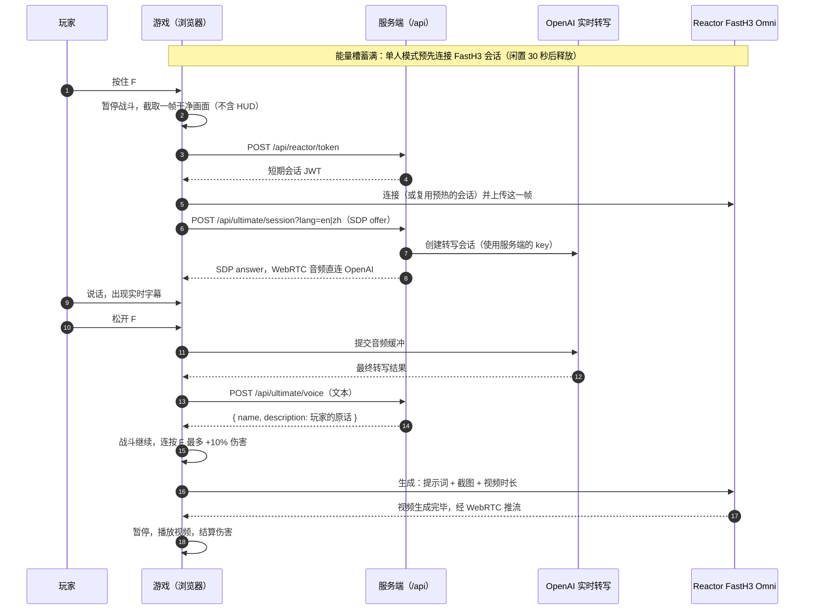

<div align="center">

# Agora Arena

一款浏览器格斗游戏，你说出口的那句话就是你的终结技。基于 Agora RTC + RTM 实现实时语音与联机对战，OpenAI 实时转写识别语音，Reactor FastH3 Omni 生成 AI 视频。


[English](./README.md) · **简体中文**

</div>

---

攒满能量槽，按住 **F**，描述一个招式。[Reactor FastH3 Omni](https://www.reactor.inc/models/fast-h3-omni/info) 会以当前战斗画面为起点，把它变成一段电影级动画，随后这一击在游戏里真实命中。可以和电脑对战，也可以在 [Agora](https://www.agora.io) 语音房间里和朋友联机。


| 对战 | 说出或输入你的大招 |
|---|---|
|  |  |
| **"黄金巨龙弹"** | **"巨大水龙"** |
|  |  |

下面一行是这套代码真实生成的 FastH3 Omni 画面。

## 语音大招的工作流程



- 截取的画面会成为视频的第一帧，所以动画从战斗停下的那一刻开始。
- 提示词（[`src/game/ultimatePrompt.ts`](src/game/ultimatePrompt.ts)）遵循 Reactor 的提示词指南：两位角色的外观、施法方站在哪一侧、玩家的原话、三拍动作（出现 → 冲向 → 命中）、镜头和音效。
- 连接和上传与说话同时进行；视频准备好之前，战斗一直继续。
- 伤害经由引擎结算（`Battle.queueStrike`）：对手最大血量的 30%。

## 快速开始

需要 Node.js 20 及以上。

```bash
git clone https://github.com/zicojiao/agora-arena.git
cd agora-arena
npm ci
cp .env.example .env.local   # 填入下面的 key
npm run dev                  # http://localhost:5173，/api 在同一进程中运行
```

| 变量 | 用途 |
|---|---|
| `AGORA_APP_ID`、`AGORA_APP_CERTIFICATE` | 联机房间。[Agora 控制台](https://console.agora.io)：App ID + Token 鉴权，开通信令（RTM） |
| `REACTOR_API_KEY` | 所有大招。参见 [FastH3 Omni API](https://docs.reactor.inc/model-api-reference/fast-h3-omni/overview) |
| `OPENAI_API_KEY` | 语音大招（`gpt-live-transcribe`）；不配置也可以打字输入 |
| `ARENA_ACCESS_PASSWORD` | 仅线上部署：整个站点共用的访问密码 |

## 怎么玩

| 按键 | 作用 |
|---|---|
| `A` / `D` | 移动（连按两次冲刺） |
| `W` / `S` | 跳跃 / 下蹲 |
| `J` | 攻击（连续按打出连击） |
| `U` `I` `O` | 技能 |
| `L` | 防御 |
| `F` | 按住说出你的大招；生成期间连按可增加伤害 |
| `Esc` | 暂停 |

打中对手和被打中都会填充蓝色的 **FastH3** 能量槽。能量槽发光时按住 F，等出现"请说中文"，描述招式后松开。也可以直接打字输入。手机上拖动屏幕左半边移动，使用右侧的按钮。

## 联机 1v1

1. 创建房间，分享六位数字房间码或邀请链接。
2. **Agora RTC** 负责语音聊天；**Agora RTM** 负责操作、选人和房间事件。
3. 两个浏览器运行同一个确定性模拟，以帧同步方式推进（输入延迟 8 帧，约 133 毫秒）。
4. 放大招时两边在同一帧暂停，施法方的视频作为 Agora 视频轨发布到房间，双方都看完后结算相同的伤害。

## 架构

```text
src/
  App.tsx              单人对局流程和大招编排
  h3-session.ts        FastH3 Omni 会话：连接 → 上传截图 → 生成
  engine/              确定性格斗引擎和电脑 AI
  render/              Canvas 渲染、精灵图、特效、音频
  game/                能量槽、实时转写、提示词、设置
  online/              Agora 房间（RTC + RTM）和帧同步
  ui/                  菜单、HUD、大招面板、触屏操作
  i18n/                中英文文案
server/index.js        签发 token、转写中继、招式命名
api/, middleware.js    Vercel 入口和密码门
wrangler.jsonc         Cloudflare Workers 配置
```

| 接口 | 作用 |
|---|---|
| `POST /api/reactor/token` | 短期 FastH3 会话 token |
| `GET /api/agora/token` | 单个频道的 Agora RTC + RTM token |
| `POST /api/ultimate/session` | 把 SDP offer 转发给 OpenAI 实时转写 |
| `POST /api/ultimate/voice` | 返回 `{ transcript, name, description }`，不调用大模型 |
| `GET /api/health` | 哪些服务已配置 |

服务商的 key 永远不会到达浏览器。线上站点的每个页面和接口都需要 `ARENA_ACCESS_PASSWORD`，未配置时一律拒绝访问；每次大招都会产生费用，请保持开启。

## 测试与部署

```bash
npm run verify           # 测试（第三方服务均为桩）、类型检查、构建
npm run deploy:vercel    # 先 `vercel link`，并为每个变量执行 `vercel env add`
npm run deploy:workers   # 先 `wrangler login`，并为每个变量执行 `wrangler secret put`
```

## 许可证

[MIT](LICENSE)。欢迎贡献，参见 [CONTRIBUTING.md](CONTRIBUTING.md)。
